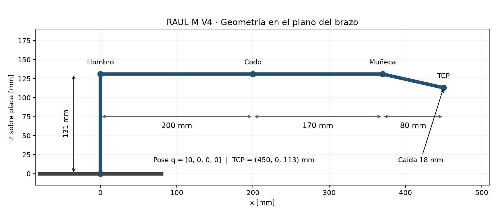
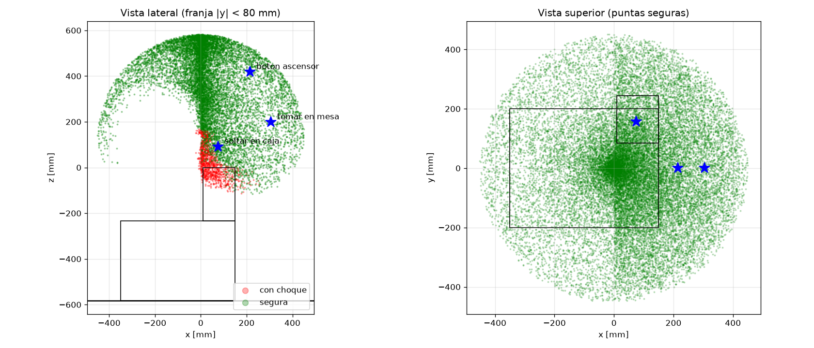
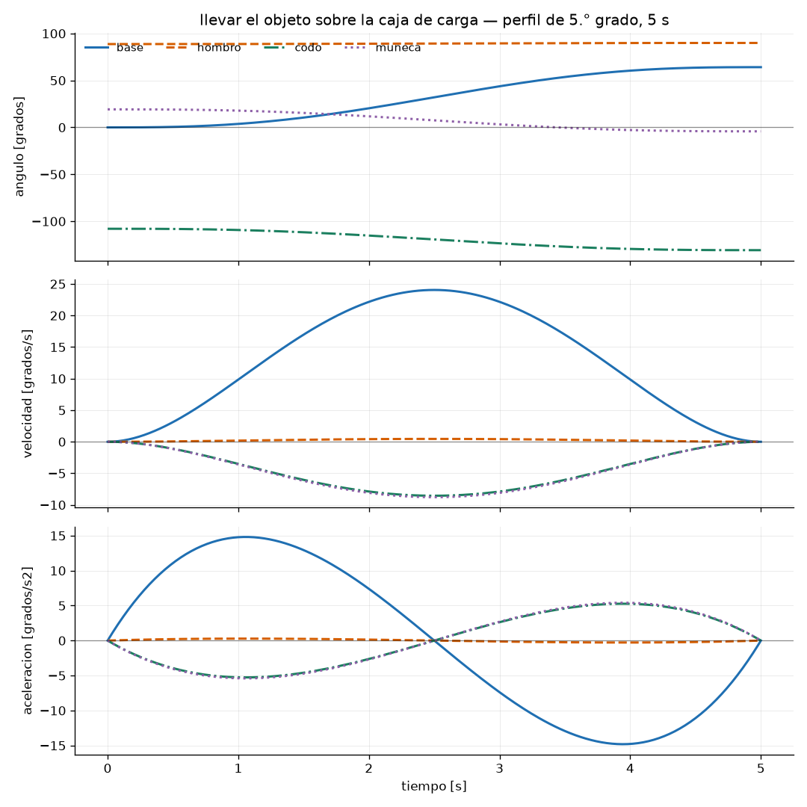
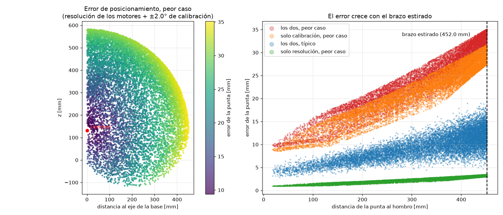

# Proyecto RAUL-M
## Informe de laboratorio y guía técnica del Equipo 4

Tecnología de Control y Robótica · UTEC · ITR Oeste, Fray Bentos · Curso 2026

Docentes: Leonardo Eguia y Rodrigo Sosa.

Integrantes consignados: Gevont Utmazian, Valentin Rodriguez y Lucas Ferreira.

Entrega: 30/10/2026. Revisión técnica: 29/10/2026.

## 1 Objetivos y alcance

El trabajo del Equipo 4 consiste en modelar y controlar el manipulador diseñado por el Equipo 3. Se obtuvieron los parámetros D-H, se implementaron la cinemática directa e inversa en Python y C++, y se construyó un entorno PyBullet con las rutinas de tomar un objeto, depositarlo en la carga y aproximar la pinza al botón del ascensor.

El modelo vigente corresponde al CAD RAUL_M.step y a la ficha RAUL_M_V4_parametros_modelo_2D.pdf. Tiene cuatro articulaciones y una pinza, accionadas por ocho MG995. La proyección horizontal con el brazo y la pinza horizontales es 450 mm. No existe una quinta articulación de giro longitudinal de muñeca.

Las verificaciones numéricas comprueban la consistencia del modelo y la ejecución de las rutinas en el escenario propuesto. No sustituyen la validación física. El cálculo estático identifica un incumplimiento: con 0,2 kg en la punta, el hombro necesita 2,869 N·m en horizontal, por encima de los 1,96 N·m de bloqueo ideal sumado del par de MG995 a 6 V.

## 2 Materiales y organización

| Elemento | Uso |
|---|---|
| Python, NumPy y PyBullet | Cinemática, entorno y comprobación de colisiones |
| Matplotlib y Pillow | Figuras y demostración animada |
| python-docx y LibreOffice | Actualización del Word original y exportación a PDF |
| g++ y simulacro de Arduino/Wire | Pruebas del C++ en la computadora |
| ESP32 y PCA9685 | Control propuesto; lógica I2C y ocho salidas PWM |
| Ocho MG995 | Base: uno; hombro, codo y muñeca: dos cada uno; pinza: uno |

La instalación y los comandos están en README.md y environment.yml. Las versiones efectivamente utilizadas y la huella del código se registran en evidencia_pruebas.txt. La referencia del repositorio es https://github.com/utma-tech/RAUL-M-equipo4; la evidencia corresponde a los archivos de esta entrega local.

<!-- pagina -->
## 3 Geometría y parámetros V4

Se usan milímetros y grados en Python y firmware; el URDF usa metros y radianes. El origen está en la cara inferior de la placa de montaje del brazo. El eje z apunta hacia arriba; x hacia adelante en la orientación cero de la base. La ficha 2D usa juntas sobre +y; nuestro convenio usa -y para que un ángulo positivo levante el brazo. El cambio de signo no altera las dimensiones.

| Parámetro | Valor vigente | Referencia |
|---|---|---|
| D1 | 131 mm | Cara inferior de placa a eje del hombro |
| A2 | 200 mm | Hombro a codo |
| A3 | 170 mm | Codo a muñeca |
| LARGO_PINZA | 80 mm | Desplazamiento longitudinal muñeca a TCP |
| CAIDA_PINZA | 18 mm | TCP por debajo del eje de muñeca |
| D5 | 82 mm | sqrt(80² + 18²) |
| FI | 12,6804° | atan2(18, 80) |

Con q = [0, 0, 0, 0], el TCP está en (450, 0, 113) mm. La distancia máxima geométrica desde el hombro es A2 + A3 + D5 = 452 mm, alineando el segmento muñeca-TCP. Es diferente de los 450 mm de proyección horizontal de la pose de referencia. La cota geométrica superior sobre la placa es 583 mm; el espacio utilizable depende de límites y obstáculos.

| Articulación | Mínimo | Máximo |
|---|---|---|
| Base q1 | -90° | 90° |
| Hombro q2 | 0° | 180° |
| Codo q3 | -150° | 30° |
| Muñeca q4 | -90° | 90° |

Estos rangos representan la asignación de 180° de servo al modelo; deben calibrarse contra los topes reales. La pose REPOSO = [0, 90, -150, 60] deja el TCP en (165, 0, 165,776) mm. PLEGADO es un alias de la misma pose, no otra configuración.

| Conjunto V4 | Masa kg | COM local x, z en mm | Inercia de junta en COM kg·m² |
|---|---|---|---|
| Eslabón 1, servos y soportes del codo | 0,266 | 138,6; 0 | 0,00152 |
| Eslabón 2, servos y soportes de muñeca | 0,281 | 125; 0 | 0,000912 |
| Muñeca y pinza, con servo | 0,186 | 29,4; -26,8 | 0,000183 |
| Torre | 0,363 | 0; -43,3 desde hombro | No informada |

Las masas V4 son estimaciones con PLA macizo a 1,24 g/cm³, servos de 55 g y rodamientos de 4,7 g. No son pesadas del prototipo. El URDF conserva estas masas agregadas; dedos y TCP auxiliares tienen masa cero para no contarlos dos veces. Las inercias no informadas fuera del eje de junta son aproximaciones, por lo que no se certifica dinámica tridimensional.

<!-- pagina -->
## 4 Modelo matemático

El vector articular es q = [q1, q2, q3, q4]. La pose controlada es [x, y, z, pitch], donde pitch = q2 + q3 + q4. El TCP se ubica en la punta de las mordazas.

### 4.1 Denavit-Hartenberg estándar

| Fila | theta | d mm | a mm | alpha |
|---|---|---|---|---|
| 1 | q1 | 131 | 0 | 90° |
| 2 | q2 | 0 | 200 | 0° |
| 3 | q3 | 0 | 170 | 0° |
| 4 | q4 - FI | 0 | 82 | 0° |
| 5 fija | FI | 0 | 0 | 0° |

La quinta fila es una transformación fija, no un grado de libertad. Corrige la orientación del marco después de trasladar el origen al TCP descentrado. Cada transformación es A = Rz(theta) Tz(d) Tx(a) Rx(alpha), y T = A1 A2 A3 A4 A5.

```text
      [ cosθ  -sinθ cosα   sinθ sinα   a cosθ ]
A  =  [ sinθ   cosθ cosα  -cosθ sinα   a sinθ ]
      [  0        sinα        cosα       d   ]
      [  0         0           0        1   ]
```

La cuarta columna de T contiene la posición. La primera columna es la dirección de apuntamiento. La orientación completa del marco D-H difiere del marco URDF por una rotación fija alrededor del eje de apuntamiento; la prueba compara posición y dirección, no igualdad de los tres ejes de ambos marcos.

### 4.2 Cinemática directa

Con p = q2 + q3 + q4:

```text
r = 200 cos(q2) + 170 cos(q2+q3) + 82 cos(p-FI)
z = 131 + 200 sin(q2) + 170 sin(q2+q3) + 82 sin(p-FI)
x = r cos(q1)                 y = r sin(q1)
pitch = p
```

En el código las funciones trigonométricas reciben radianes mediante conversión explícita. La contribución de la pinza también puede escribirse como 80 cos(p) + 18 sin(p) en r, y 80 sin(p) - 18 cos(p) en z. La concordancia de ambas implementaciones y el producto D-H se verifica numéricamente.

<!-- pagina -->
### 4.3 Cinemática inversa

Para la rama implementada, el TCP está delante de la base y el codo toma la solución de ángulo negativo. Dada una pose (x, y, z, p):

```text
q1 = atan2(y, x)
rw = sqrt(x²+y²) - 82 cos(p-FI)
zw = z - 131 - 82 sin(p-FI)
c3 = (rw²+zw²-200²-170²)/(2·200·170)
q3 = -acos(c3)
q2 = atan2(zw,rw) - atan2(170 sin(q3),200+170 cos(q3))
q4 = p - q2 - q3
```

Si c3 queda fuera de [-1,1], la pose está fuera de alcance. Si la solución viola los rangos articulares, se informa fuera de límites. El algoritmo no explora todas las ramas: que rechace una pose no demuestra que ninguna configuración física pueda alcanzarla. En particular, no se implementó la rama por detrás del hombro. No se admite orientación roll independiente.

### 4.4 Movimiento suave

Cada tramo se interpola en espacio articular, por lo que la trayectoria del TCP no es necesariamente una recta. Con u = t/T:

```text
s(u) = 10u³ - 15u⁴ + 6u⁵
q(t) = q_inicial + (q_final-q_inicial) s(u)
s'(u) = 30u² - 60u³ + 30u⁴
s''(u) = 60u - 180u² + 120u³
```

La velocidad y la aceleración son cero en los dos extremos. El pico de velocidad es 1,875 veces la velocidad media. Para cada articulación se exige T >= 1,875 |delta q| / 90, con T en segundos y ángulos en grados. El firmware rechaza tiempos no positivos, números no finitos y movimientos que excedan ese límite. Las pruebas de rutina también fallan ante un exceso de velocidad.

En PyBullet el camino se comprueba con muestras separadas por como máximo 2° de recorrido articular. En el firmware se comprueban 20 posiciones contra un piso virtual de 30 mm sobre la referencia de la placa; no existe allí detección de mesa, panel ni autocolisión. Ambos usan el mismo perfil, pero sus comprobaciones del entorno son distintas.

La continuidad del perfil reduce cambios bruscos del mando; no acredita ausencia de vibración del mecanismo real. Frenar retiene el último mando, sin una rampa específica de frenado.

<!-- pagina -->
## 5 Modelo URDF y escenario



Figura 1. Dimensiones de la ficha V4, referidas a ejes y TCP. El esquema describe el brazo, no dimensiones confirmadas del vehículo.

El URDF aproxima piezas mediante cajas y cilindros. Incluye base, torre, brazo, antebrazo, conjunto de muñeca-pinza, TCP y dos mordazas. Las mordazas reales giran; en la simulación deslizan simétricamente. Es una simplificación para visualizar agarre y colisiones, no una reproducción exacta del mecanismo dentado.

| Parámetro del escenario | Valor propuesto |
|---|---|
| Plataforma sobre piso | 350 mm |
| Alzador adicional | 233 mm; no forma parte del CAD |
| Cara inferior de placa sobre piso | 583 mm |
| Hombro sobre piso | 714 mm |
| Plataforma | 500 × 400 mm; eje del brazo a 150 mm del borde delantero |
| Mesa | Tapa a 750 mm; borde a x = 270 mm |
| Cubo | Lado 50 mm; centro en (320, 0, 192) mm del brazo |
| Caja de carga | 140 × 160 × 233 mm; centro (80, 165, -116,5) mm |
| Panel | Cara frontal x = 230 mm; botón a 1000 mm del piso |
| Margen nominal de colisión | 10 mm para el brazo; 0 para el objeto transportado |

La caja queda delante y a la izquierda, y sobresale 45 mm del lateral de la plataforma supuesta. Mesa y ascensor se representan como estaciones distintas. Al cambiar entre ellas permanecen el piso, la plataforma, la caja y el pedestal.

Los 233 mm son una solución de montaje del escenario ensayado, no una medida del Equipo 3 ni un mínimo global demostrado. Sin alzador, la cota geométrica superior sobre el piso sería 350 + 131 + 452 = 933 mm, inferior al botón supuesto a 1000 mm. La integración física requiere acordar altura, estabilidad y posición de la caja con los otros equipos. El vehículo sigue siendo una aproximación; falta el URDF del Equipo 2.

<!-- pagina -->
## 6 Rutinas y alcance

Las rutinas se construyen en rutinas.py. Mapas, análisis de error y verificación del ejemplo ESP32 comparten los TCP efectivos mediante poses_tarea(), evitando coordenadas copiadas con alturas diferentes.

| Tarea | TCP x, y, z en mm | Pitch | Error angular estimado mm |
|---|---|---|---|
| Agarrar en mesa | 305; 0; 197 | 0° | 26,5 |
| Soltar en carga | 75,373; 155,456; 90,607 | -45° | 19,5 |
| Aproximar al botón | 215; 0; 417 | 0° | 25,6 |

Los errores de la tabla corresponden al modelo de cuantización más ±2° por junta; no son errores medidos en el prototipo. Se calculan en el TCP, no en el centro del objeto.

La toma empieza con pinza abierta, sube por encima de la mesa, baja frente al objeto, entra 60 mm y lo levanta. La punta muerde 10 mm de su cara; el desplazamiento respecto del centro es -15 mm. La altura de agarre es 30 mm sobre la tapa.

El depósito orienta la pinza a -45°, pasa sobre la caja y baja hasta la referencia del objeto situada 80 mm por encima de su tapa. Al soltar, el modelo baja el objeto hasta una superficie de apoyo. Después retira la pinza y vuelve a REPOSO.

La aproximación al ascensor se hace con la pinza cerrada. El retiro es 120 mm, y el TCP final está a x = 215 mm, 15 mm por delante del panel. El botón se representa con una marca; no se simula su recorrido, fuerza de contacto ni accionamiento eléctrico. La rutina demuestra posicionamiento de la pinza, no valida físicamente la pulsación.



Figura 2. Muestreo de 30 000 configuraciones con semilla fija. El mapa considera plataforma, pedestal, caja y autocolisiones seleccionadas. La mesa y el panel se comprueban durante las rutinas, no en este mapa general. Un punto alcanzable no implica un camino libre hasta él.

<!-- pagina -->
## 7 Trayectorias y limitaciones del agarre



Figura 3. Traslado desde la mesa hacia la caja de carga. Las cuatro articulaciones comparten un tramo de 5 s con perfil de quinto grado; posiciones, velocidades y aceleraciones se calculan a partir de la rutina efectiva.

Las tres secuencias y el regreso al reposo se comprueban en pruebas_rutinas.py. La demostración se regenera con grabar_demo.py usando cuadros de PyBullet. Si una etapa falla, el generador se detiene y no rotula una secuencia incompleta como exitosa.

El modelo se posiciona con resetJointState, sin integración dinámica. El objeto agarrado conserva una transformación relativa a la pinza. No se calculan fricción, fuerza de cierre, deslizamiento ni deformación. Una animación exitosa no demuestra que el objeto de 50 mm pueda sujetarse con el mecanismo real.

La luz dibujada en el CAD es aproximadamente 14,8 mm, en una sola pose. La apertura de 50 mm utilizada en simulación debe confirmarse físicamente. Los contactos entre eslabones vecinos se excluyen de ciertos chequeos; las formas son envolventes simplificadas. El muestreo a 2° puede omitir un contacto entre muestras, por lo que no constituye una prueba de colisión continua.

El margen nominal de 10 mm tampoco absorbe automáticamente el error de posicionamiento, que supera ese valor bajo la hipótesis de ±2°. Se necesita calibración, mayor separación o comprobación adicional antes de ejecutar cerca de obstáculos reales.

<!-- pagina -->
## 8 Error de posicionamiento

Se separan la cuantización de PWM y la incertidumbre angular de calibración. A 50 Hz, el período nominal de 20 000 µs dividido en 4096 cuentas da 4,8828125 µs por cuenta. Con 11,11 µs por grado, la resolución nominal es 0,4395° y la desviación de redondeo está limitada a media cuenta por canal.

El firmware redondea al entero más cercano. El modelo de cuantización incorpora el pulso cero del servo principal de cada junta (1500, 500, 2167 y 1500 µs). Los pares enfrentados necesitan calibración individual; el análisis no modela esfuerzos internos por diferencias entre ambos servos.

La hipótesis de calibración es ±2° en cada una de las cuatro juntas. Se evalúan 16 combinaciones de signos para estimar el extremo de error y diez perturbaciones uniformes por pose para la media típica. El barrido principal usa 12 000 configuraciones con semilla fija, incluidas poses que podrían chocar: es un análisis geométrico, no un mapa de operación segura.

En el barrido principal, la media típica combinada es 9,7 mm y el máximo muestreado es 35,1 mm. En la prueba de regresión de 3000 configuraciones, la media típica combinada es aproximadamente 9,6 mm y el máximo muestreado aproximadamente 35,1 mm. Las cotas de regresión se ajustan al modelo V4: 12 mm para la media típica y 40 mm para el máximo del ensayo. Son umbrales para detectar cambios de código, no tolerancias certificadas del robot.



Figura 4. Estimación geométrica de resolución y calibración para el modelo actual. La calibración aporta aproximadamente nueve veces el error extremo medio de la cuantización. Los máximos son resultados de muestreo, no cotas globales demostradas.

El ensayo no incluye holguras, flexión, error de longitud, histéresis, carga ni variación de alimentación. Falta medir el TCP del prototipo en varias poses, repetir aproximaciones desde ambos sentidos y registrar error absoluto y repetibilidad respecto de una referencia independiente.

<!-- pagina -->
## 9 Verificación estática de actuadores

La ficha V4 aporta masas y centros de masa agregados. Se calcula el par de sostén como derivada de la energía potencial respecto de cada ángulo. Para el brazo horizontal, sin carga:

```text
tau_hombro = 9,81 [0,266·0,1386 + 0,281·(0,200+0,125)
                  + 0,186·(0,370+0,0294)] = 1,9863 N·m
tau_codo   = 9,81 [0,281·0,125 + 0,186·(0,170+0,0294)]
           = 0,7084 N·m
tau_muñeca = 9,81·0,186·0,0294 = 0,0536 N·m
```

La carga de 0,2 kg en el TCP agrega m·g multiplicado por la distancia horizontal al eje de cada junta. En poses generales se conserva el signo de las palancas; no se suman valores absolutos de torques que podrían compensarse.

| Junta | Horizontal sin carga N·m | Horizontal con 0,2 kg N·m | Máximo con carga, malla 10° N·m |
|---|---|---|---|
| Hombro | 1,9863 | 2,8692 | 2,8853 |
| Codo | 0,7084 | 1,1989 | 1,2150 |
| Muñeca | 0,0536 | 0,2106 | 0,2267 |

El barrido recorre 6859 configuraciones de hombro, codo y muñeca, sin filtrar colisiones. La rotación de base no cambia el torque gravitatorio con el vehículo horizontal. Su torque de aceleración y rozamiento no se evaluó.

La ficha informa 0,83 N·m por MG995 a 4,8 V y 0,98 N·m a 6 V. La suma ideal del par es 1,66 y 1,96 N·m respectivamente (la ficha redondea el primero como 1,67). El bloqueo no es torque continuo utilizable y supone reparto ideal entre ambos motores.

El hombro supera incluso el bloqueo ideal a 6 V en horizontal y sin carga. Por eso, reducir la carga útil a cero no resuelve el requisito a máxima extensión. Debe redimensionarse la actuación, incorporarse una transmisión adecuada o compensarse el peso, y luego verificar también velocidad, estabilidad y temperatura. Que codo y muñeca queden por debajo del bloqueo no certifica margen de operación continua.

pruebas_modelo.py contrasta el cálculo analítico sin carga con la dinámica inversa del URDF en 100 poses aleatorias. El error máximo obtenido es 6,66e-16 N·m. También verifica la masa total modelada de 1,096 kg (torre y tres conjuntos móviles) y evita duplicar dedos y TCP.

<!-- pagina -->
## 10 Firmware y conexión electrónica

El firmware contiene cinemática, driver I2C del PCA9685, interpolación suave, pinza, frenado y apagado de salidas. El sketch alterna entre dos poses de ejemplo actualizadas: mesa (305,0,197,0) y botón (215,0,417,0). No ejecuta las listas completas de toma y depósito de Python.

| Conexión | Asignación |
|---|---|
| ESP32 GPIO 21 | SDA del PCA9685 |
| ESP32 GPIO 22 | SCL del PCA9685 |
| PCA9685 VCC | Lógica 3,3 V |
| PCA9685 GND | Masa común con ESP32 y fuente de servos |
| PCA9685 V+ | Fuente de potencia de servos, separada de la lógica |
| Dirección I2C | 0x40 |
| PWM | 50 Hz nominales |

| Articulación | Canales PWM | Pulsos cero µs | Pendientes µs/grado |
|---|---|---|---|
| Base | 0 | 1500 | +11,11 |
| Hombro | 1 y 2 | 500 y 2500 | +11,11 y -11,11 |
| Codo | 3 y 4 | 2167 y 833 | +11,11 y -11,11 |
| Muñeca | 5 y 6 | 1500 y 1500 | +11,11 y -11,11 |
| Pinza | 7 | Abrir 1000; cerrar 2000 | Mandos provisionales |

Los valores de pulso son parámetros iniciales para calibrar. Los servos enfrentados deben producir el mismo ángulo mecánico sin forzar el eje. La fuente, los conductores, las protecciones y el corte de potencia deben dimensionarse con las corrientes reales de los ocho actuadores; no se acredita una corriente de fuente suficiente sin esa comprobación.

No hay homing ni lectura externa de posición. Al iniciar se comanda ARRANQUE = [0,0,0,90]; el controlador no conoce por ello la posición física previa. El paso a REPOSO dura 4 s. Las pruebas de escritorio verifican mandos, límites, perfiles y escritura de registros; no verifican seguimiento real, par ni comunicación I2C en hardware.

La tabla define el cableado funcional, pero no reemplaza el diagrama eléctrico completo del módulo transversal. Quedan pendientes ese diagrama con protecciones y alimentación, y la matriz de selección ponderada con disponibilidad local. La insuficiencia del hombro obliga a revisar la selección antes de cerrar el hardware.

<!-- pagina -->
## 11 Resultados de verificación

La ejecución completa se registra en Entregables/evidencia_pruebas.txt con fecha UTC, versiones y SHA256 de código y modelo. El ejecutor recompila las pruebas C++ y no reutiliza ejecutables de una revisión anterior. La falta de compilador o una suite fallida produce un resultado incompleto y código de salida distinto de cero.

| Verificación | Resultado de esta revisión |
|---|---|
| Forma cerrada frente a D-H | Error máximo 1,7e-13 mm |
| Ida y vuelta FK/IK, rama implementada | Error máximo 1,7e-13 |
| Posición URDF frente a D-H | Error máximo 3,0e-5 mm |
| Dirección de pinza URDF frente a D-H | Error máximo 3,8e-7 |
| C++ frente a Python | 999 casos; error máximo impreso 0,0001 |
| Movimiento C++ con Arduino/Wire simulado | Registros, servos enfrentados, límites, velocidad y frenado |
| Rutinas PyBullet | Toma, depósito, regreso y aproximación al botón |
| Error de posicionamiento | Resolución coherente y cotas V4 satisfechas |
| Modelo y datos | Masas, estática, pedestal persistente y TCP de firmware coherentes |

Las pruebas automatizadas no equivalen a una aceptación completa del enunciado. La situación de cada requisito es la siguiente.

| Requisito | Estado |
|---|---|
| D-H, cinemática directa e inversa | Implementados y verificados numéricamente |
| Código documentado y URDF del brazo | Incluidos |
| Tres rutinas de manipulación | Demostradas con modelo cinemático simplificado |
| Integración con URDF de RAUL del Equipo 2 | Pendiente; se usa plataforma aproximada |
| Error de posicionamiento en simulación | Estimado bajo hipótesis angulares explícitas |
| Error en prototipo físico | Pendiente de medición |
| Firmware compilado para ESP32 y probado en banco | Pendiente; C++ probado en computadora |
| Carga útil de 0,2 kg a máxima extensión | No satisfecha por el hombro con datos V4 |
| Apertura y fuerza real de pinza | Pendientes de confirmar |
| Matriz electrónica y diagrama completo | Pendientes del trabajo compartido |

## 12 Conclusiones

El proyecto queda consistente con la geometría y las masas V4 y dispone de una demostración reproducible de las rutinas en el escenario propuesto. La validación detecta un límite físico que el software no corrige: el hombro necesita una solución de actuación distinta para cumplir el requisito de carga. Antes del montaje operativo deben cerrarse ese dimensionamiento, la integración de RAUL, la calibración de servos y las mediciones del prototipo.

<!-- pagina -->
## 13 Reproducción y referencias

Desde la raíz del proyecto, con el entorno raul_sim activado:

```text
python correr_pruebas.py
python simulacion/demo_rutinas.py
python simulacion/mapa_alcance.py
python simulacion/graficos_trayectoria.py
python simulacion/error_posicionamiento.py
python simulacion/torques.py
python simulacion/ficha_medidas.py
python simulacion/grabar_demo.py
```

El modo articular permite explorar las cuatro juntas. El modo cartesiano recibe posición y pitch, resuelve la rama de IK disponible y comunica límites o choques. Los comandos de instalación y la solución de errores en Windows están en README.md. La configuración comprobada usa Python 3.11 y pybullet-arm64 3.2.8 en el entorno raul_sim; no se debe reinstalar si ya funciona. No se requiere una copia de ejecutables compilados ni archivos de caché.

Cuando cambie una dimensión se deben actualizar parametros.py, configuracion.h y brazo.urdf. Un cambio del entorno se realiza en escena.py; las rutinas se definen en rutinas.py. El análisis de tareas utiliza las poses de esas rutinas. Después de cualquier modificación deben volver a generarse la evidencia, las figuras, la animación, el Word y el PDF.

### Fuentes del proyecto

1. Enunciado Proyecto 2: ampliación de RAUL-M, Tecnología de Control y Robótica, ITR Oeste, curso 2026. Archivo suministrado: Proyecto-v2026-TDCR-2 (2).pdf. Define las actividades y entregables de los Equipos 3 y 4 y la carga de 0,2 kg a máxima extensión.

2. Equipo 3. RAUL_M.step, CAD recibido el 29/10/2026. Referencia del ensamblaje, ejes y geometría aproximada de colisión.

3. Equipo 3. Brazo RAUL_M V4 - Parámetros del modelo 2D para PyBullet, recibido el 29/10/2026. Fuente de longitudes, masas, centros de masa, inercias y valores típicos de los MG995. El cálculo de este informe usa esos datos y sus supuestos de materiales.

4. Código de esta entrega: cinematica.py, cinematica.cpp, brazo.urdf, rutinas.py, error_posicionamiento.py y torques.py. La evidencia reproducible identifica la revisión mediante SHA256.

### Archivos de entrega

El informe es Informe_Equipo4_RAUL-M.docx, con su PDF exportado desde ese archivo. La demostración animada se genera con grabar_demo.py a partir de PyBullet. Las figuras vigentes, el código, las pruebas y el CAD acompañan la entrega. No se incluyen informes de versiones anteriores, grabaciones antiguas, binarios ni resultados duplicados.
